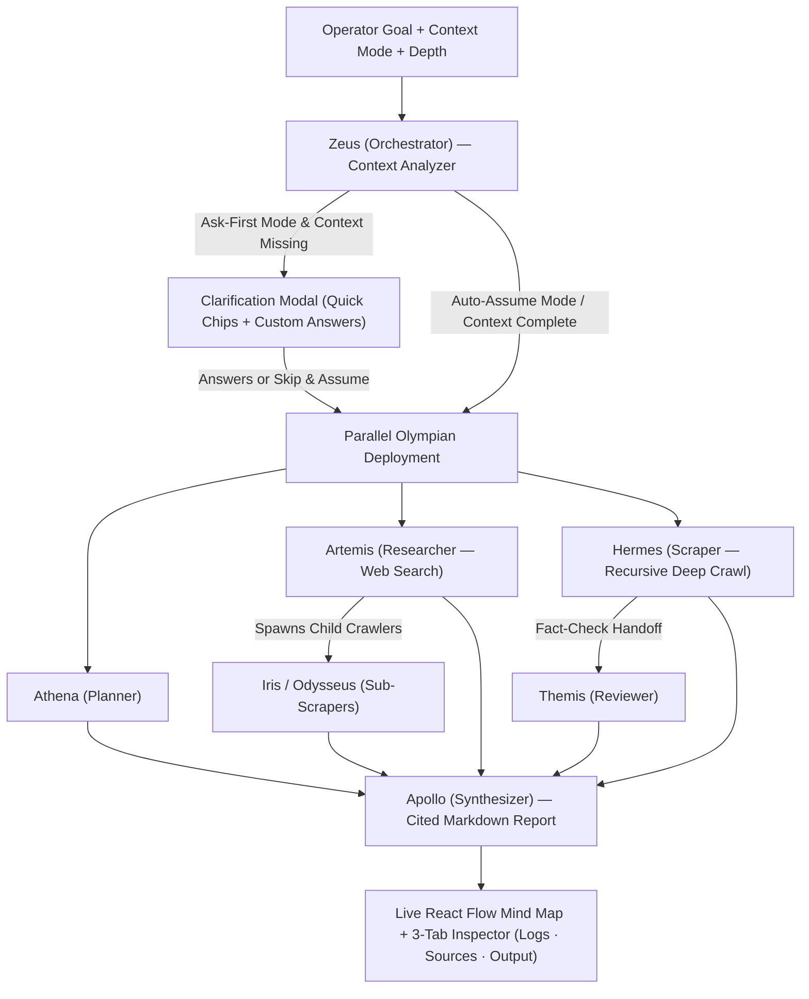

# Pantheon v2: The Bot Overlord


**Pantheon v2** is a real, live multi-agent **Bot Manager & Deep Web Research Control Plane** inspired by Greek Mythology. Deploy any mission to **Zeus**, choose whether Zeus pauses to clarify missing context (**Ask First**) or infers smart defaults autonomously (**Auto-Assume**), and watch a live Olympian swarm (**Athena**, **Artemis**, **Hermes**, **Iris**, **Themis**, **Apollo**, and more) spawn in parallel, search the web, recursively deep-crawl websites, and compile cited Markdown reports on an interactive Mind Map.

---

## Versions & Branches

| Version | Branch | Status | Summary |
| :--- | :--- | :--- | :--- |
| **v1.0.0** | [`main`](https://github.com/MechDev578/pantheon/tree/main) | Stable | Pure frontend Bot Mind Map visualizer (offline mock simulator, Netlify web app, macOS `.app`, MCP App) |
| **v2.0.0** *(current)* | [`v2`](https://github.com/MechDev578/pantheon/tree/v2) | Active | Real multi-provider AI orchestration engine, Ask-First vs. Auto-Assume context modes, live web search & recursive website deep-crawling, Greek mythology bot personas, Local Engine + Netlify Cloud |
| **v3.0.0** | *Planned* | Roadmap | Action-capable bots with human-in-the-loop approvals — hotel & restaurant bookings, automated trip reservations, landlord email outreach, calendar sync, and external OAuth integrations |

---

## Architecture Overview



---

## Greek Mythology Pantheon Roster

When missions scale up to 20 bots, Pantheon automatically assigns unique Greek mythological identities from its primary and secondary deity rosters ([`engine/pantheonRoster.ts`](engine/pantheonRoster.ts)):

| Primary Deity | Epithet | Role | Core Specialty |
| :--- | :--- | :--- | :--- |
| **Zeus** | King of Olympus | `Orchestrator` | Evaluates context, asks clarifying questions or logs assumptions, decomposes goals, and commands parallel sub-agents |
| **Athena** | Goddess of Strategy | `Planner` | Designs evaluation rubrics, comparison criteria, and multi-track research plans |
| **Artemis** | Goddess of the Hunt | `Researcher` | Runs multi-angle web searches to surface authoritative primary websites, official pricing, and reviews |
| **Hermes** | Swift Messenger & Crawler | `Scraper` | Deep-crawls websites (`deep_crawl`), parses structured tables/headings/policies, and extracts verified URLs |
| **Daedalus** | Master Architect | `Architect` | Structures itineraries, system architectures, and decision matrices |
| **Hephaestus** | God of the Forge | `Coder` | Crafts code, schemas, and technical specifications grounded in live docs |
| **Themis** | Goddess of Verification | `Reviewer` | Cross-checks facts, spots hidden fees/taxes, and audits source consistency |
| **Cerberus** | Guardian of the Gates | `Tester` | Stress-tests budgets, timelines, constraints, and edge cases |
| **Apollo** | God of Light & Prophecy | `Synthesizer` | Compiles every Olympian's findings and scraped URLs into a final executive Markdown report |

*Overflow secondary deities summoned for parallel waves:* **Iris**, **Odysseus**, **Prometheus**, **Mnemosyne**, **Hecate**, **Helios**, **Selene**, **Nike**, **Poseidon**, **Atlas**, **Ares**, **Hera**, **Orpheus**, **Aether**, **Chronos**, **Persephone**, **Demeter**, **Hestia**, **Hyperion**, and **Nyx**.

---

## Core Capabilities

### 1. Context Strategy Toggle (`Ask First` vs. `Auto-Assume`)
- **Ask First (`ask`):** Zeus evaluates your goal before deploying bots. If key constraints are missing (budget, dates, location, audience, depth), Zeus enters `waiting` state and surfaces 2–4 targeted questions with clickable suggested chips + custom text inputs (plus a 1-click **Skip — Assume Context & Deploy** override).
- **Auto-Assume (`auto`):** Zeus infers sensible defaults, records every assumption transparently in both the telemetry log and final report, and deploys the swarm immediately.

### 2. Crawl & Swarm Depth Presets

| Preset | Max Bots | Max Tree Depth | Pages per Deep Crawl | Best For |
| :--- | :---: | :---: | :---: | :--- |
| **Quick** | 6 | `L2` | Up to 3 pages (`d1`) | Fast answers & quick multi-site comparisons |
| **Deep** *(default)* | 12 | `L3` | Up to 6 pages (`d2`) | Thorough product, travel, hotel, or market research |
| **Abyssal** | 20 | `L3` | Up to 10 pages (`d3`) | Exhaustive recursive multi-site audits with nested sub-crawlers |

### 3. Real Web Search & Recursive Website Deep-Crawling
- **Zero-Key Web Search:** Built-in ad-filtered DuckDuckGo HTML/Lite + Wikipedia fallback works out of the box. Optionally add a **Tavily** or **Brave Search** API key in Settings for faster search throughput.
- **Deep Website Extraction (`cheerio`):** Strips script/nav/cookie noise while preserving headings, Markdown tables, pricing, lists, and policies. Automatically filters out alternate-language mirrors (`/fr/`, `/de/`, `/it/`, etc.) so crawl budget focuses on unique content pages (`/rooms`, `/pricing`, `/amenities`, `/faq`, `/policies`, `/docs`).
- **SSRF Protection:** Blocks non-`http(s)` protocols, `localhost`, `.local`/`.internal`, and private/metadata IP ranges (`10.x`, `127.x`, `169.254.x`, `172.16–31.x`, `192.168.x`).

### 4. Multi-Provider AI Brain
Bring your own API key for any supported provider (configured via local `.env` or the UI **Settings** modal):
- **Google Gemini** (`gemini-2.5-flash`, `gemini-2.5-pro`, `gemini-2.0-flash`, or custom model ID)
- **OpenAI** (`gpt-4o-mini`, `gpt-4o`, `gpt-4.1-mini`, `gpt-4.1`, `o3-mini`, or custom model ID)
- **Anthropic Claude** (`claude-3-5-haiku-latest`, `claude-sonnet-4-20250514`, `claude-3-7-sonnet-latest`, or custom model ID)

### 5. Interactive Live Mind Map & 3-Tab Inspector
- Real-time node cards show each deity's **active tool ticker** (`Deep crawling...`, `Searching...`, `Awaiting Hermes`), **scraped websites count**, **child bots count**, and **log count**.
- Click any node to open the **3-Tab Inspector**:
  1. **Logs:** Streaming color-coded telemetry (`INFO`, `TOOL`, `MIND`, `WARN`, `OK`, `ERR`).
  2. **Sources:** Every website scraped by that bot with clickable URLs, domain, word count, crawl depth, and snippet preview.
  3. **Output:** The bot's compiled findings — plus full **Apollo Mission Report** viewer with **Copy Markdown** and **Download `.md`**.
- **Deploy Sub-Bot Inline:** Click `+ Sub-Bot` on any node in Local Engine mode to summon an extra live Olympian under that specific bot with a custom follow-up directive.
- **Built-in Demo Mode:** Toggle between **Local Engine / Netlify Cloud** and **Demo** anytime to preview the Greek mythology swarm without an API key.

---

## Quick Start

### Option A — Local Full-Power Mode (Recommended)
Unlimited runtime, full recursive crawl depth, local mission history persistence, and follow-up sub-bot deployment:

```bash
git clone -b v2 https://github.com/MechDev578/pantheon.git
cd pantheon
npm install

# Optional: configure server-side keys in .env (or enter keys directly in the UI Settings modal)
cp .env.example .env

# Starts BOTH the Local Pantheon Engine (:8787) and React UI (:5173)
npm run dev
```

1. Open `http://localhost:5173`.
2. Click **Settings** (top-right) to select **Gemini**, **OpenAI**, or **Anthropic** and paste your API key (skipped automatically if detected from `.env`).
3. Pick a starter template or enter any goal, choose **Ask First** or **Auto-Assume**, select **Quick / Deep / Abyssal**, and click **Deploy Pantheon**.

### Option B — Deploy Cloud Mode on Netlify
Pantheon v2 ships ready for Netlify Functions:
1. Connect your GitHub repo to Netlify and deploy the **`v2`** branch (`netlify.toml` builds `dist/` and bundles `netlify/functions/pantheon.mts` at `/api/cloud/*`).
2. Optionally set `GEMINI_API_KEY`, `OPENAI_API_KEY`, or `ANTHROPIC_API_KEY` in Netlify Site Environment Variables (scoped to **Functions**), or let visitors bring their own key via the UI **Settings** modal.
3. Cloud missions stream live via SSE (`ReadableStream`) within Netlify's 60-second streaming window, with mission history saved locally in the browser.

### Option C — Standalone macOS Desktop App (`.app`)
```bash
npm run build:desktop
```
Builds `release/Bot Mind Map.app`.

---

## Environment Variables (`.env.example`)

| Variable | Required | Description |
| :--- | :---: | :--- |
| `GEMINI_API_KEY` | Optional* | Google Gemini API key |
| `OPENAI_API_KEY` | Optional* | OpenAI API key |
| `ANTHROPIC_API_KEY` | Optional* | Anthropic Claude API key |
| `TAVILY_API_KEY` | Optional | Enhanced web search via Tavily API |
| `BRAVE_SEARCH_API_KEY` | Optional | Enhanced web search via Brave Search API |
| `PANTHEON_PORT` | Optional | Local engine port (default: `8787`) |

*\*At least one AI provider key is required for live missions — either in `.env`, Netlify environment variables, or entered directly in the UI Settings modal. Keys entered in the UI stay strictly in browser `localStorage` and are never written to disk or Git.*

---

## Local & Cloud API Endpoints

| Runtime | Endpoint | Description |
| :--- | :--- | :--- |
| Local | `GET /api/health` | Engine runtime info & detected `.env` providers |
| Local | `GET /api/missions` | List persisted mission history |
| Local | `POST /api/missions` | Create mission & run Zeus context analysis (+ auto-execution) |
| Local | `GET /api/missions/:id/stream` | Real-time SSE telemetry stream |
| Local | `POST /api/missions/:id/answer` | Submit clarifying answers (or skip & assume) to resume Zeus |
| Local | `POST /api/missions/:id/spawn` | Deploy a live follow-up Olympian under any selected bot |
| Local | `POST /api/missions/:id/abort` | Abort an active mission |
| Cloud | `GET /api/cloud/health` | Netlify Cloud capabilities check |
| Cloud | `POST /api/cloud/analyze` | Fast context analysis & clarifying question generation |
| Cloud | `POST /api/cloud/execute` | Live SSE streaming multi-agent mission execution |

---

## Project Structure (`v2`)

```text
pantheon/
├── engine/                           # Shared runtime-agnostic multi-agent core
│   ├── types.ts                      # Canonical Mission, Bot, Source & SSE types
│   ├── pantheonRoster.ts             # Greek mythology deities, personas & depth presets
│   ├── llmClient.ts                  # Unified Gemini / OpenAI / Anthropic tool-calling client
│   ├── webTools.ts                   # Ad-filtered web search, HTML scraper & deep crawler
│   ├── agentRunner.ts                # ReAct loop + parallel sub-agent spawning
│   └── missionOrchestrator.ts        # Zeus Context Analyzer -> Parallel Swarm -> Apollo Report
├── server/
│   └── index.ts                      # Local Mac Node.js HTTP + SSE engine (:8787)
├── netlify/functions/
│   └── pantheon.mts                  # Netlify Cloud Function (/api/cloud/*) with SSE streaming
├── src/
│   ├── hooks/usePantheon.ts          # Unified Local Engine + Netlify Cloud + Demo state manager
│   ├── engine/mockOrchestrator.ts    # Greek mythology offline Demo simulator
│   └── components/
│       ├── graph/                    # BotGraphCanvas, BotNode (Greek deity cards), BotEdge
│       ├── header/                   # HeaderToolbar (runtime switcher, stats, controls)
│       ├── inspector/                # 3-tab Logs/Sources/Output Inspector + Sub-Bot deployer
│       ├── mission/                  # MissionLauncher, ClarificationModal, MissionReportModal
│       └── settings/                 # Multi-provider AI & Search key configuration modal
├── desktop/                          # Native macOS Swift + WKWebView wrapper
├── .env.example                      # Environment variable template
├── netlify.toml                      # Netlify build & Functions config
├── tsconfig.server.json              # Strict TypeScript config for engine/server/netlify
└── package.json
```

---

## Scripts

| Command | Description |
| :--- | :--- |
| `npm run dev` | Run both the Local Pantheon Engine (`:8787`) and Vite UI (`:5173`) |
| `npm run dev:ui` | Run the Vite frontend only |
| `npm run server` | Run the Local Pantheon Engine with hot reload |
| `npm run server:start` | Run the Local Pantheon Engine once (no watcher) |
| `npm run typecheck` | Strictly type-check frontend, engine, server, and Netlify function |
| `npm run build` | Type-check everything and build production bundle to `dist/` |
| `npm run build:mcp` | Build single-file HTML bundle for Antigravity MCP App |
| `npm run build:desktop` | Build standalone macOS `.app` bundle |

---

## Roadmap (`v3`)
- **Action-Capable Bots with Human-in-the-Loop Approvals:** Book hotels, plan & reserve restaurant tables, draft and send landlord outreach emails, and sync itineraries to Google Calendar / Gmail with explicit operator confirmation gates before any external action or payment.
- **Persistent Vector Memory (`Mnemosyne`):** Remember user travel preferences, budgets, dietary needs, and past missions automatically across sessions.
- **Headless Browser Scraping Plugin:** Optional Playwright sidecar for heavy JS-rendered booking portals.
